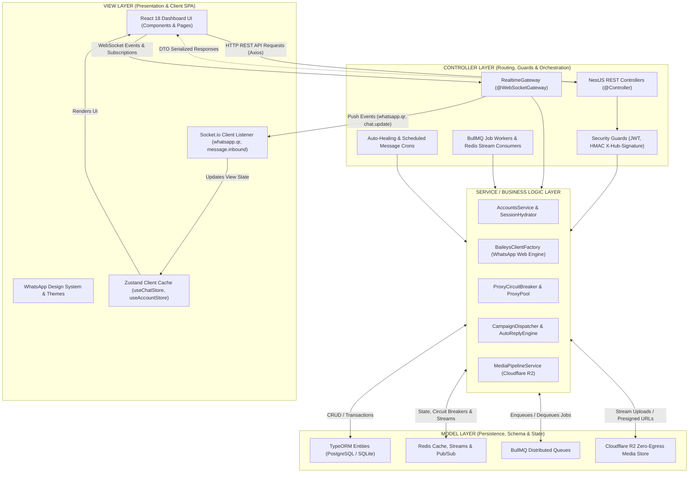
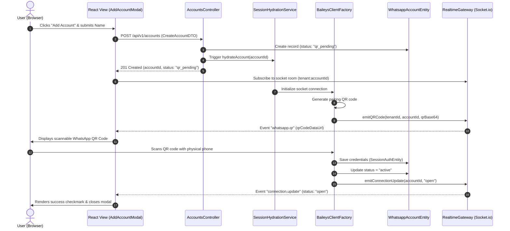
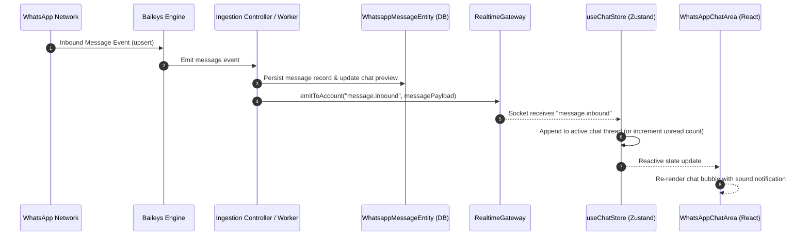
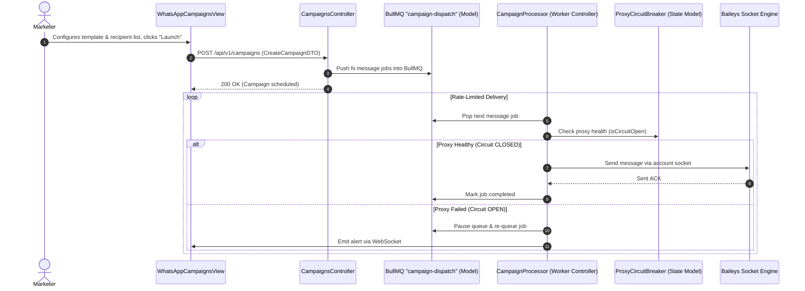

# MVC Architecture Specification
## WhatsApp Automation Engine — Multi-Tenant Core Platform

---

## 1. Executive Architecture Summary

This platform implements a **Modern Decoupled Multi-Tier Model-View-Controller (MVC)** architecture. Unlike monolithic MVC systems where HTML templates are rendered synchronously on the server, this enterprise platform splits the responsibilities across:

- **Model (M)**: Distributed domain data and state machines implemented with **TypeORM Entities** (PostgreSQL / SQLite), **Redis In-Memory State & Streams**, **BullMQ Queue Schemas**, and **Zustand Client-side Stores**.
- **View (V)**: A high-performance **React 18 SPA (Vite)** presentation layer, **JSON API Serialization DTOs**, **Socket.io Real-Time Push Events**, and **Cloudflare R2 Media Streams**.
- **Controller (C)**: **NestJS HTTP Controllers**, **Socket.io WebSocket Gateways**, **BullMQ Background Workers & Cron Processors**, and **Frontend Client Services & Event Handlers**.



---

## 2. Model Layer (M)

The **Model Layer** represents the single source of truth for business data, domain logic invariants, and operational state.

### 2.1 Relational & Persistence Models (TypeORM)
Located in `src/modules/*/entities/*.entity.ts`, these entities map directly to the relational database (PostgreSQL in production, SQLite in local/dev):

| Entity (Model) | Location | Primary Responsibilities |
| :--- | :--- | :--- |
| `WhatsappAccountEntity` | [`whatsapp-account.entity.ts`](file:///c:/Users/dhyey/OneDrive/Desktop/whatsapp%20-%20Copy/src/modules/session-hydration/entities/whatsapp-account.entity.ts) | Account identity, proxy assignment, connection status (`pending`, `active`, `banned`, `qr_pending`). |
| `SessionAuthEntity` | [`session-auth.entity.ts`](file:///c:/Users/dhyey/OneDrive/Desktop/whatsapp%20-%20Copy/src/modules/session-hydration/entities/session-auth.entity.ts) | AES-256 encrypted Baileys multi-device authentication credentials and encryption keys. |
| `WhatsappMessageEntity` | [`whatsapp-message.entity.ts`](file:///c:/Users/dhyey/OneDrive/Desktop/whatsapp%20-%20Copy/src/modules/session-hydration/entities/whatsapp-message.entity.ts) | Chat messages, timestamps, delivery statuses (`sent`, `delivered`, `read`), media URLs. |
| `WhatsappChatEntity` | [`whatsapp-chat.entity.ts`](file:///c:/Users/dhyey/OneDrive/Desktop/whatsapp%20-%20Copy/src/modules/session-hydration/entities/whatsapp-chat.entity.ts) | Thread conversations, unread counters, last message previews, pinned states. |
| `WhatsappContactEntity` | [`whatsapp-contact.entity.ts`](file:///c:/Users/dhyey/OneDrive/Desktop/whatsapp%20-%20Copy/src/modules/session-hydration/entities/whatsapp-contact.entity.ts) | WhatsApp contacts, profile pictures, verified business badges, push names. |
| `AppUserEntity` | [`app-user.entity.ts`](file:///c:/Users/dhyey/OneDrive/Desktop/whatsapp%20-%20Copy/src/modules/auth/entities/app-user.entity.ts) | Multi-tenant users, role-based access control (`SUPER_ADMIN`, `ADMIN`, `USER`), hashed passwords. |
| `CampaignEntity` & `CampaignRecipientEntity` | [`campaign.entity.ts`](file:///c:/Users/dhyey/OneDrive/Desktop/whatsapp%20-%20Copy/src/modules/campaigns/entities/campaign.entity.ts) | Bulk messaging campaigns, scheduled execution, recipient lists, delivery stats. |
| `ChatbotFlowEntity` & `ConversationMemoryEntity` | [`chatbot-flow.entity.ts`](file:///c:/Users/dhyey/OneDrive/Desktop/whatsapp%20-%20Copy/src/modules/chatbot/entities/chatbot-flow.entity.ts) | Visual flow builder nodes, keyword matching, context state for conversational AI. |
| `ContainerInstanceEntity` & `ContainerHealLogEntity` | [`container-instance.entity.ts`](file:///c:/Users/dhyey/OneDrive/Desktop/whatsapp%20-%20Copy/src/modules/orchestration/entities/container-instance.entity.ts) | Docker Swarm container tracking, CPU/RAM telemetry, auto-heal event audit trail. |
| `ProxyPoolEntity` & `ProxyCircuitBreakerEntity` | [`proxy-pool.entity.ts`](file:///c:/Users/dhyey/OneDrive/Desktop/whatsapp%20-%20Copy/src/modules/proxy-binding/entities/proxy-pool.entity.ts) | SOCKS5/HTTP proxies, latency health scores, fail counts, and circuit breaker trip states. |
| `TemplateEntity` | [`template.entity.ts`](file:///c:/Users/dhyey/OneDrive/Desktop/whatsapp%20-%20Copy/src/modules/templates/entities/template.entity.ts) | Reusable message templates with parameter placeholders (e.g. `{{name}}`). |
| `ContactGroupEntity` | [`contact-group.entity.ts`](file:///c:/Users/dhyey/OneDrive/Desktop/whatsapp%20-%20Copy/src/modules/contacts/entities/contact-group.entity.ts) | Tagged contact segments and group memberships for targeted broadcast blasts. |

### 2.2 Transient & In-Memory Models (Redis & BullMQ)
- **Redis Stream Buffer**: `wa:webhooks:incoming` acting as a persistent append-only event log for webhook events.
- **Circuit Breaker State Machine**: 3-state model (`CLOSED`, `HALF_OPEN`, `OPEN`) stored in Redis keys with automatic TTL expiration.
- **BullMQ Queue Models**: Rate-limited token bucket state preventing WhatsApp account bans via sliding-window throttling.

### 2.3 Client-Side Models (Zustand Stores)
Located in `frontend/src/stores/`:
- `useAccountStore`: Account selection, connection health, and account-level metrics.
- `useChatStore`: Thread list, active chat, message history, contacts, and optimistic message state.
- `useUIStore`: Active navigation rail tabs, modal open/close states, dark/light themes.

---

## 3. View Layer (V)

The **View Layer** encompasses both the client-facing presentation and the server-side response format serialization.

### 3.1 Client Presentation Layer (React 18 SPA)
Located in `frontend/src/`:
- **Core Chat Interface**:
  - `WhatsAppNavRail`: Navigation bar switching between Chats, Campaigns, Chatbot, Health, and Settings.
  - `WhatsAppChatsList`: Virtualized chat conversation list with unread badges, avatars, and search.
  - `WhatsAppChatArea`: Message bubbles, media previews, voice notes, delivery checkmarks, and message input composer.
  - `WhatsAppRightPanel` & `WhatsAppSmartMessagingPanel`: Contextual contact info, quick replies, and auto-reply inspectors.
- **Management & Operational Views**:
  - `WhatsAppAccountsManagerDashboard`: Multi-account manager with proxy stats, session health, and QR code pairing modals.
  - `WhatsAppCampaignsView`: Campaign creation wizard, CSV upload, recipient targeting, and real-time delivery graphs.
  - `WhatsAppChatbotFlowBuilderView`: Visual drag-and-drop conversational automation engine.
  - `WhatsAppInstanceManagerView`: Container instance health, memory/CPU charts, and manual reboot triggers.
  - `WhatsAppSuperAdminControlCenter`: User management, tenant quotas, proxy pool assignment, and system audit logs.
  - `LoginPage`: Authentication view with JWT session initialization and password recovery flows.

### 3.2 Real-Time Push Views (Socket.io WebSocket Events)
Emitted by `RealtimeGateway` (`src/modules/realtime-gateway/gateways/realtime.gateway.ts`) to drive real-time UI updates without polling:
- `whatsapp.qr`: Emits live base64 QR codes directly to `AddAccountModal` for instant scanning.
- `connection.update`: Emits real-time state (`open`, `connecting`, `close`) to update account status badges.
- `message.inbound`: Delivers incoming WhatsApp messages instantly into the active chat window.
- `message.ack`: Updates checkmarks from single check (sent) to double check (delivered) to blue double check (read).

### 3.3 Media Presentation Layer (Cloudflare R2 Zero-Egress)
- Direct streaming of inbound WhatsApp media (photos, voice notes, documents) via signed URLs, eliminating backend egress bandwidth.

---

## 4. Controller Layer (C)

The **Controller Layer** intercepts incoming requests, enforces authentication/authorization, validates data transfer objects (DTOs), coordinates business services, and selects the appropriate View response.

### 4.1 REST API Controllers (NestJS `@Controller`)
Located in `src/modules/*/controllers/*.controller.ts`:

```
┌───────────────────────────────────────────────────────────────────────────────┐
│ REST API Controllers                                                          │
├────────────────────────┬─────────────────────┬────────────────────────────────┤
│ Controller             │ Route Base          │ Responsibilities               │
├────────────────────────┼─────────────────────┼────────────────────────────────┤
│ AccountsController     │ /api/v1/accounts    │ Account CRUD, pairing, health  │
│ WhatsAppWebController  │ /api/v1/wa-web      │ Messages, chats, contacts sync │
│ AuthController         │ /api/v1/auth        │ Login, register, JWT refresh   │
│ CampaignsController    │ /api/v1/campaigns   │ Broadcast campaign execution   │
│ ChatbotController      │ /api/v1/chatbot     │ Bot triggers, flow execution   │
│ ContactsController     │ /api/v1/contacts    │ Contact books, CSV import/export│
│ MessageQueueController │ /api/v1/queue       │ BullMQ job stats, pause/resume │
│ MediaPipelineController│ /api/v1/media       │ Media upload, presigned URLs   │
│ OrchestrationController│ /api/v1/containers  │ Docker Swarm & Coolify scaling │
│ SecurityGuardController│ /api/v1/security    │ HMAC validation & audit logs   │
│ AutoReplyController    │ /api/v1/auto-reply  │ Keyword response rules         │
│ SchedulerController    │ /api/v1/scheduler   │ Timed message execution        │
│ HealthController       │ /health             │ Kubernetes / Docker liveness   │
└────────────────────────┴─────────────────────┴────────────────────────────────┘
```

### 4.2 WebSocket Gateways (`@WebSocketGateway`)
- **`RealtimeGateway`** (`src/modules/realtime-gateway/gateways/realtime.gateway.ts`):
  - Manages client connection lifecycle (`OnGatewayConnection`, `OnGatewayDisconnect`).
  - Implements tenant-level room isolation (`joinRoom('tenant:<id>:account:<id>')`).
  - Distributes real-time socket events across multi-node server clusters using `@socket.io/redis-adapter`.

### 4.3 Background Workers & Cron Controllers
- **BullMQ Processors**: Pull outbound messages from priority queues, throttle according to account warm-up rules, check circuit breakers, and invoke Baileys socket dispatchers.
- **Redis Stream Consumer Groups**: Read incoming webhooks from `wa:webhooks:incoming` asynchronously to ensure immediate 200 OK responses to webhook senders.
- **Auto-Healing Cron Worker**: Runs every 60s to inspect stalled container instances and initiate automatic restarts.

---

## 5. End-to-End MVC Request Lifecycles

### Flow A: Account QR Code Pairing Flow


### Flow B: Inbound Message Ingestion & View Synchronization


### Flow C: Outbound Campaign Dispatch with Rate-Limiting & Circuit Breakers


---

## 6. MVC Component Mapping Matrix

| Functional Feature | Model (Data / State) | View (Presentation / UI) | Controller (Logic / Routing) |
| :--- | :--- | :--- | :--- |
| **Authentication & RBAC** | `AppUserEntity`, `PasswordResetEntity`, JWT Tokens | `LoginPage.tsx`, `SuperAdminDashboard.tsx` | `AuthController`, `JwtAuthGuard`, `RolesGuard` |
| **WhatsApp Accounts** | `WhatsappAccountEntity`, `SessionAuthEntity` | `AccountsManagerModal.tsx`, `WhatsAppNavRail.tsx` | `AccountsController`, `SessionHydrationService` |
| **Live Chat & Messaging** | `WhatsappMessageEntity`, `WhatsappChatEntity` | `WhatsAppChatArea.tsx`, `WhatsAppChatsList.tsx` | `WhatsAppWebController`, `RealtimeGateway` |
| **Contact Directory** | `WhatsappContactEntity`, `ContactGroupEntity` | `WhatsAppContactGroupsView.tsx`, `Contacts.tsx` | `ContactsController` |
| **Automated Chatbot** | `ChatbotFlowEntity`, `ConversationMemoryEntity` | `WhatsAppChatbotFlowBuilderView.tsx` | `ChatbotController`, `ChatbotService` |
| **Auto-Reply Rules** | `AutoReplyRuleEntity` | `WhatsAppAutoReplyView.tsx`, `AutoReplyModal.tsx` | `AutoReplyController`, `AutoReplyService` |
| **Scheduled Messages** | `ScheduledMessageEntity` | `WhatsAppSchedulerView.tsx`, `ScheduledMessagesModal.tsx` | `SchedulerController`, `SchedulerService` (Cron) |
| **Bulk Campaigns** | `CampaignEntity`, `CampaignRecipientEntity` | `WhatsAppCampaignsView.tsx`, `BulkCampaigns.tsx` | `CampaignsController`, `BullMQ Worker` |
| **Message Templates** | `TemplateEntity` | `WhatsAppMessageTemplatesView.tsx` | `TemplatesController` |
| **Proxy Management** | `ProxyPoolEntity`, `ProxyCircuitBreakerEntity` | `HealthDashboard.tsx`, Proxy Modals | `ProxyBindingController`, `ProxyCircuitBreakerController` |
| **System Orchestration**| `ContainerInstanceEntity`, `ContainerHealLogEntity` | `WhatsAppInstanceManagerView.tsx` | `OrchestrationController`, Auto-Healer Worker |
| **Media Storage** | `MediaObjectEntity`, Cloudflare R2 | Zero-egress audio player, image/video lightbox | `MediaPipelineController`, `MediaPipelineService` |
| **Compliance & Opt-Out**| `OptOutEntity` | `WhatsAppComplianceOptOutView.tsx` | `OptOutController` |
| **Data Backup / Export**| `ExportLogEntity`, ZIP Archives | `ExportBackupModal.tsx`, `WhatsAppDatabaseBackupView.tsx`| `ExportBackupController` |

---

## 7. Key Architectural Best Practices in this Implementation

1. **Decoupled Client-Server MVC**:
   - The presentation layer is decoupled from server compute. The backend controllers serve structured JSON/WebSocket views, allowing the frontend to be swapped, updated, or deployed independently.
2. **Fat Models, Lean Controllers**:
   - NestJS Controllers strictly handle request validation, parameter transformation, and response mapping. Core business validation, rate-limiting algorithms, and session orchestration reside in isolated injectable services and domain entities.
3. **Stateless Scalability**:
   - Session authentication state is hydrated from the database into RAM on-demand. All WebSocket communication is synchronized across nodes using Redis adapters, allowing any number of backend container replicas to serve traffic seamlessly.
4. **Single-Direction Data Flow on the Client**:
   - React components consume centralized Zustand stores (`useChatStore`, `useAccountStore`, `useUIStore`). Server-sent events update the store, and the store reactively triggers UI re-renders without prop drilling or stale state.

---

## 8. The 10 Architectural Commandments Enforcement Matrix

| # | Commandment | Architecture Implementation | Key Files / Modules |
| :--- | :--- | :--- | :--- |
| **1** | **Clean folder structure** | Consolidated view components into `components/WhatsAppWeb/`, domain API modules into `services/api/`, design primitives into `components/ui/`, and custom business logic into `hooks/`. | `frontend/src/components/WhatsAppWeb/`, `frontend/src/services/api/`, `frontend/src/components/ui/` |
| **2** | **Separate logic from UI** | Extracted 250+ lines of monolithic socket management, multi-device sync, and account switching out of `App.tsx` into custom React hooks. | `frontend/src/hooks/useWhatsAppSocket.ts`, `frontend/src/hooks/useAccountSwitcher.ts`, `frontend/src/hooks/useModalManager.ts` |
| **3** | **Remove duplicate & dead code** | Decommissioned 9 legacy redundant prototype directories (`Migration/`, `BulkCampaigns/`, `Chatbot/`, `Contacts/`, `InstanceManager/`, `OptOut/`, `Analytics/`, `Templates/`, `Verification/`) in favor of unified `WhatsAppWeb/` components. | Removed 9 obsolete folders |
| **4** | **Consistent naming conventions** | Uniform `*View.tsx` for views, `*Modal.tsx` for overlays, `*.api.ts` for domain API modules, and `use*.ts` for hooks. | Codebase-wide |
| **5** | **Proper error handling** | Typed `ApiError` hierarchy in frontend Axios interceptors, centralized `HttpExceptionFilter` in backend NestJS with stack-trace sanitization in production. | `frontend/src/services/api/client.ts`, `src/common/filters/http-exception.filter.ts` |
| **6** | **Separate env configs** | Strongly typed `ENV` singleton validating URLs, ports, tenant keys, and runtime environment. | `frontend/src/config/env.ts` |
| **7** | **Modularize reusable components** | Created accessible design primitives strictly adhering to the Anti-Gimmick Design Manifesto (geometric 4px–8px radius, solid high contrast, no green gradients, no emojis). | `frontend/src/components/ui/Button.tsx`, `Badge.tsx`, `Card.tsx`, `ModalShell.tsx` |
| **8** | **Proper state management** | Fully typed Zustand stores managing accounts, chats, and UI/modal state with zero prop-drilling. | `frontend/src/stores/accountStore.ts`, `chatStore.ts`, `uiStore.ts` |
| **9** | **Document the codebase** | Comprehensive architectural documentation, JSDoc headers on domain modules, and audit traceability. | `MVC_ARCHITECTURE.md`, `audit_and_remediation_plan.md` |
| **10** | **Scalable API structure** | Decomposed monolithic `api.ts` into domain modules (`accounts`, `whatsapp`, `campaigns`, `chatbot`, `auth`, `export`, `verification`, `infrastructure`) with backward-compatible barrel facade. | `frontend/src/services/api/index.ts`, `frontend/src/services/api.ts` |

